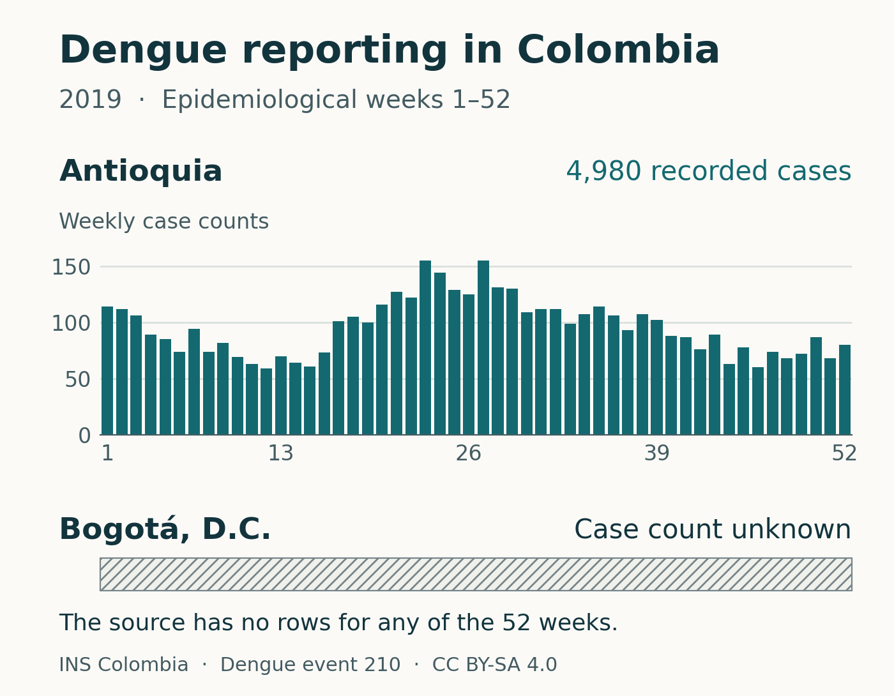
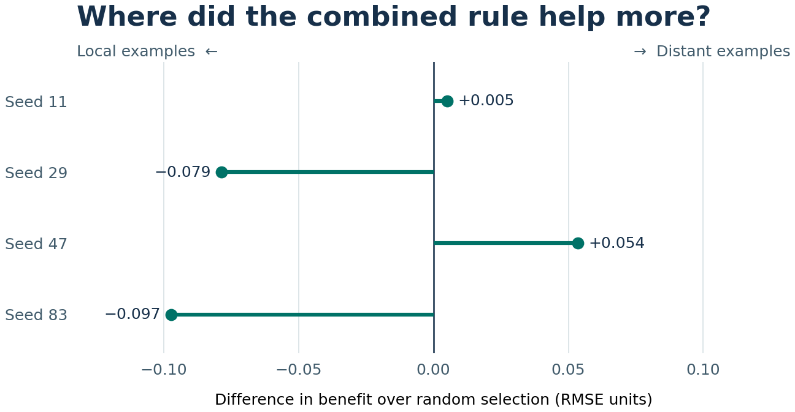

# Brandon J. Huynh, MPH

I’m an infectious disease and public health researcher with a background in chemistry, molecular laboratory science, epidemiology, and biostatistics. I build tools to answer a question that comes up at the bench and in surveillance data alike. What can these measurements tell us?

## Why is Bogotá hatched on the dengue map?

In 2019, Colombia’s public surveillance data recorded **4,980 dengue cases in Antioquia**, with records in all 52 weeks. The same source has **no dengue records for Bogotá in any of those weeks**. Bogotá’s case count is unknown. I used hatching in the Colombia Dengue Surveillance Atlas so a reader could see that gap on the map.

[Explore Antioquia in 2019](https://thethunda01.github.io/colombia-dengue-atlas/explore.html?department=05&event=210&start=2019&end=2019&first=1&last=52&metric=rate) · [Compare Bogotá for the same weeks](https://thethunda01.github.io/colombia-dengue-atlas/explore.html?department=11&event=210&start=2019&end=2019&first=1&last=52&metric=rate)

Each bar sums one week of published counts from Colombia’s National Institute of Health. A week with records can still miss cases. The Atlas lets you inspect weekly coverage, the population denominator, and the values behind the map. [Weekly source data](https://github.com/TheThunda01/colombia-dengue-atlas/blob/v1.1.0/data/processed/surveillance_weekly.csv) · [Data attribution and terms](https://github.com/TheThunda01/colombia-dengue-atlas/blob/v1.1.0/DATA_LICENSE.md) · [Download the department totals](https://raw.githubusercontent.com/TheThunda01/colombia-dengue-atlas/v1.1.0/data/processed/map_comparison.csv)

## Explore another question

| Question | Where to start |
| --- | --- |
| How does a surveillance trend change when you leave out the most recent weeks? | [Inspect the CDC data audit](https://github.com/TheThunda01/surveillance-data-quality/blob/main/results_public/report.md) |
| Can two reviewers trace a disagreement to its source? | [Compare two synthetic extraction tables in EvidenceTrail](https://thethunda01.github.io/evidencetrail/) |
| How well does a fitted curve pin down an enzyme’s parameters? | [Compare the full and reduced concentration ranges](https://github.com/TheThunda01/enzyme-kinetics-workbench/blob/main/docs/profile-explorer.md) |

## When a prediction fell short

I expected a rule that combined uncertainty and diversity to help most on the more distant green fluorescent protein (GFP) variants. I compared it with random selection using four starting samples from archived brightness measurements. Two comparisons favored my prediction and two went the other way. On average, the combined rule helped more on the local variants.

All four comparisons used the same evaluation observations. The report shows the error for each selection rule and the differences across starting samples. [Read the GFP comparison](https://github.com/TheThunda01/gfp-active-learning/blob/4b27c32047288e32a647e2e8b411f3b272d6113c/experiments/uncertainty_ablation/results/report.md) · [Inspect the figure data](https://github.com/TheThunda01/gfp-active-learning/blob/4b27c32047288e32a647e2e8b411f3b272d6113c/experiments/uncertainty_ablation/results/distance_benefit_contrast.csv)

## More of my work

The project guide covers fourteen research and software demonstrations, the Atlas, and the *Beyond the Bug* book project. It includes the MAPK signaling simulation and Nature’s Perfume Lab, a visual introduction to plant aroma chemistry. [Find a project](PROJECT_GUIDE.md) · [See what I’m investigating next](PORTFOLIO_PLAN.md)

I developed these projects with AI assistance. I use attributed public data and labeled simulations. Each repository describes its inputs, the checks I used, and the limits of its conclusions. [Methods and standards](PORTFOLIO_STANDARDS.md) · [Glossary](docs/glossary.md) · [Sources](REFERENCES.md) · [Maintenance](MAINTENANCE.md)
